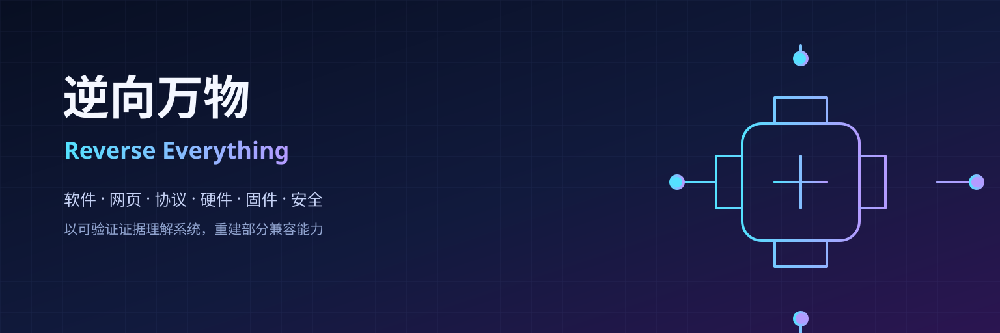

# Reverse Everything

**Local AI-assisted reverse engineering and digital compatibility reconstruction · v0.0.4 development branch**

[](https://github.com/alicia1030su/reverse-everything/actions/workflows/ci.yml)
[](LICENSE)
[简体中文](README.md)



Reverse Everything turns **authorized targets** into traceable analysis jobs: real tool output, persisted stages, recoverable state, reproducible checks, and downloadable artifacts. It is not a decompiler leaderboard and does not promise unconditional recovery.

> Analyze only targets you own or are explicitly authorized to inspect. Do not bypass login, captcha, paywall, DRM, anti-cheat, or access controls. v0.0.4 is developed on `feat/v0.0.4-hardware-lab`; this page does not claim that a tag or stable release has been published.

## v0.0.4 entrypoints

Web, REST, CLI, MCP, and Skill share one task engine. The nine entrypoints below are not necessarily new adapters.

| Entrypoint | Inputs and outputs | Actual routing and boundary |
|---|---|---|
| `website` | DOM, scripts, routes, forms, screenshots, same-origin network metadata | `website` adapter; no access-control bypass; local demos require separate confirmation |
| `software` | PE/ELF/Mach-O, sections/imports, entropy, bounded strings, ZIP, SBOM | `file` adapter; unknown programs are not executed |
| `android` | Safe APK/ZIP inventory, AXML manifest, DEX tables, native-library metadata | `apk` adapter; JADX decompilation code exists but remains `PARTIAL` until real CI evidence is complete |
| `game` | Protocol fields, state transitions, and an independent compatibility service from a lawful replay | `game` adapter; not recovery of the original server |
| `network` | HAR, PCAP, PCAPNG endpoints, HTTP/DNS/TLS and transport metadata | `network` adapter; offline uploads only; targets inside captures are not contacted |
| `security` | Passive HTTP header/cookie/CORS checks, static CWE candidates, SARIF | `security` adapter; no exploitation or unauthorized active scanning |
| `usb` USB hardware | USB identity/topology, offline PCAP/PCAPNG/usbmon, HID descriptors, snapshots | Project kind and adapter are both `hardware`; read-only enumeration; no device handles, live capture, or keystroke capture |
| `firmware` | BIN/IMG, Intel HEX, UF2, ELF, layout, entropy, strings, component/SBOM clues | `firmware` adapter; bounded static analysis; no execution, runtime unpacking, or flashing |
| `board` | Board USB/HID/enumeration records and read-only serial inventory | **Hardware scenario routing**: project kind and adapter are both `hardware`; it does not call `firmware` and claims no brand/model-specific or live-device support |

Ghidra Headless is an advanced option inside the `software` card and uses the separate `ghidra` adapter. Function, pseudocode, call-graph, and string-reference code exists, but remains `PARTIAL` / `BLOCKED` until known-answer CI with real Ghidra/JDK is complete; it is not `VERIFIED`. See the [capability matrix](docs/development/V004-CAPABILITY-MATRIX.md).

## Quick start

Requirements: Node.js **22.13+**, npm, Git. Website analysis requires Chrome/Chromium.

```bash
npm ci
npm run build
npm start
```

Open <http://127.0.0.1:4173>. API and Web share the port. Startup creates `data/local-token`; never commit `data/`.

For development, start only API and the independent Worker:

```bash
npm run dev
```

Docker:

```bash
docker compose up -d --build
curl http://127.0.0.1:4173/api/health
docker compose down          # keep data
docker compose down -v       # delete the data volume
```

The host port binds only to `127.0.0.1`. USB is not mapped and privileged mode is not used by default.

## Create the first task

1. Open “New analysis” and choose one of the nine entrypoints.
2. Enter an authorized URL or select a local file. For boards, inspect read-only serial/device lists in the hardware lab.
3. Confirm authorization; local demo URLs require an additional local permission.
4. Inspect real stages, logs, evidence, and artifacts; pause, resume, cancel, or retry as needed.
5. Download `report.md`, `findings.sarif`, `manifest.json`, or compatibility-service artifacts and verify SHA-256.

Rule-based analysis works without AI configuration. AI text is always `INFERENCE` and cannot replace tool evidence.

## CLI

After building, use the repository entrypoint. Installed CLI packages expose `reverse-everything`.

```bash
node apps/cli/dist/cli.js --version
node apps/cli/dist/cli.js health
node apps/cli/dist/cli.js capabilities
node apps/cli/dist/cli.js analyzers list
node apps/cli/dist/cli.js projects list
node apps/cli/dist/cli.js projects create "Authorized sample" software --authorized
node apps/cli/dist/cli.js projects upload <projectId> ./sample.bin
node apps/cli/dist/cli.js analyze file ./sample.bin --authorized
node apps/cli/dist/cli.js analyze web https://example.com --authorized
node apps/cli/dist/cli.js tasks create <projectId> firmware
node apps/cli/dist/cli.js tasks list
node apps/cli/dist/cli.js tasks get <taskId>
node apps/cli/dist/cli.js tasks action <taskId> pause
node apps/cli/dist/cli.js report export <taskId> ./report.md
node apps/cli/dist/cli.js hardware list
node apps/cli/dist/cli.js hardware doctor
node apps/cli/dist/cli.js hardware serial
node apps/cli/dist/cli.js firmware inspect ./firmware.bin --authorized
node apps/cli/dist/cli.js resources status
node apps/cli/dist/cli.js cache stats
node apps/cli/dist/cli.js retention show
node apps/cli/dist/cli.js mcp stdio
node apps/cli/dist/cli.js mcp http --port 4174
```

Local URLs require `--confirm-local`. The CLI reads `RE_DATA_DIR/local-token` by default; override with `RE_API_URL`, `RE_API_TOKEN`, or `RE_DATA_DIR`. See the [CLI guide](docs/user-guide/CLI.md) for all commands and project-kind/adapter mappings.

## REST API, OpenAPI, and MCP

- API: `http://127.0.0.1:4173/api/v1`; `/api` remains an alias for the same handlers.
- OpenAPI: runtime `GET /api/openapi.json`, version **0.0.4**; source generator: `scripts/generate-openapi.mjs`.
- MCP: stdio and Streamable HTTP share the API and expose **21 tools**.
- Skill: `skills/reverse-everything`; prefer MCP, otherwise CLI/API.

MCP covers projects/tasks/reports, capabilities/health/resources, hardware capabilities/devices/serial/reports, evidence/events/artifact manifests, and cache listing/statistics. Cleanup, device opening, live capture, and flashing are not exposed. See the [CLI/MCP guide](docs/user-guide/CLI-MCP.md) and [API guide](docs/user-guide/API.md).

## Hardware and firmware boundaries

- USB and serial enumeration is read-only. Serial numbers are not read; device-controlled friendly names, manufacturer/driver strings, and interface/configuration free text are not returned verbatim and are represented only by one-way hashes. Serial ports are not opened and DTR/RTS are not changed.
- Hardware analysis accepts offline USB PCAP/PCAPNG, usbmon, HID descriptors, or enumeration snapshots. Raw packet payloads are not written to evidence.
- Unauthorized physical devices are not accessed. Live USB capture, driver installation, and keyboard-report capture remain disabled. Reconnect requires identity and authorization revalidation.
- Firmware analysis is bounded and static. Encrypted or high-entropy content remains `UNKNOWN`; protection is not bypassed.
- A board entrypoint grants no new execution permission: listing a serial port does not authorize login, reset, control-line changes, or flashing.

See the [security model](docs/SECURITY-MODEL.md).

## Evidence and acceptance states

- `EVIDENCE`: actual tool output.
- `INFERENCE`: rule/model inference that must be traceable.
- `UNKNOWN`: missing evidence, never disguised as a conclusion.
- `VERIFIED`: a conclusion supported by reproducible tests.

Implementation labels such as `IMPLEMENTED`, `PARTIAL`, `BLOCKED`, and `MISSING` are separate from evidence levels. Major evidence includes source, locator, and SHA-256; exported manifests record input hashes, tool versions, stages, and artifact hashes.

## Cache, retention, and deletion

- Cache covers reusable pure stages only. It is project-scoped by default; cross-project sharing requires explicit approval. Keys include input, adapter/stage/tool versions, and redacted options. Reads verify SHA-256; corrupt entries are treated as misses.
- `retention show` only displays policy. Maintenance uses preview followed by `confirm=CLEAN`. Temporary files and logs for active tasks are protected.
- Retention does not automatically delete original uploads or formal task artifacts. Cache clearing requires `confirm=CLEAR_CACHE`; project deletion requires the exact project name and is rejected while tasks are active.

## Desktop, Windows, and single instance

- Desktop metrics combine Electron `app.getAppMetrics()` with real API/Worker sidecar snapshots. Failed, stale, or truncated sampling is recorded in `limitations`; a complete process tree is never fabricated.
- Windows artifact downloads use private temporary snapshots, restricted to the current user with `icacls`, and reject reparse-point paths. POSIX uses mode 0600.
- The API uses a SQLite runtime lease to prevent multiple instances on one data directory. Electron uses a single-instance lock and focuses the existing window on a second launch.

## Tests and documentation

```bash
npm run typecheck
npm run lint
npm test
npm run test:e2e
npm run docs:check
npm run validate:skill
npm run version:check
```

Test counts, skips, CI run IDs, and gate conclusions are governed by the [v0.0.4 test results](docs/development/V004-TEST-RESULTS.md) and the final gate. Checks that did not run are not marked passed. Current limitations are listed in [v0.0.4 known issues](docs/development/V004-KNOWN-ISSUES.md).

- [PRD](docs/PRD.md) · [Architecture](docs/ARCHITECTURE.md) · [Security model](docs/SECURITY-MODEL.md) · [Roadmap](docs/ROADMAP.md)
- [CLI](docs/user-guide/CLI.md) · [CLI/MCP](docs/user-guide/CLI-MCP.md) · [API](docs/user-guide/API.md) · [Skill](docs/user-guide/SKILL.md)
- [Windows](docs/user-guide/WINDOWS.md) · [Upgrade](docs/user-guide/UPGRADE.md) · [Capability matrix](docs/development/V004-CAPABILITY-MATRIX.md)

## License

Apache-2.0. Third-party components retain their own licenses; see [NOTICE](NOTICE). Do not distribute unauthorized commercial software, firmware, or game assets with this project.
