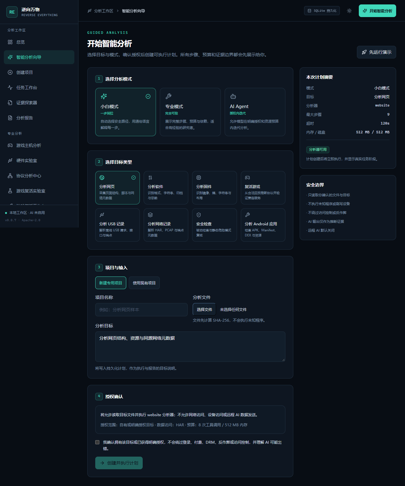

# Reverse Everything

**AI-assisted local reverse engineering, console research, and digital compatibility reconstruction · v0.0.7**

[](https://github.com/alicia1030su/reverse-everything/actions/workflows/ci.yml)
[](LICENSE)
[](https://github.com/alicia1030su/reverse-everything/releases/latest)
[简体中文](README.md)


Reverse Everything turns **authorized targets** into traceable analysis jobs: real tool output, persisted stages, recoverable state, reproducible checks, and downloadable artifacts. v0.0.7 adds Legacy Software Revival Studio, read-only identification, compatibility and lawful-license diagnostics, data recovery, independent tool generation, and V5 behavior-IR-driven anti-template game revival.

## Interface preview

| Intelligent wizard | Console Research Lab | Plain-language report |
|---|---|---|
|  |  |  |

> Analyze only targets you own or are explicitly authorized to inspect. Do not bypass login, captcha, paywalls, DRM, anti-cheat, or access controls. The project does not provide console jailbreaking, privilege escalation, secure-boot bypass, automated exploitation, or unauthorized device access. See [DISCLAIMER.en.md](DISCLAIMER.en.md).

## What is new in v0.0.7

- **Legacy Software Revival Studio**: read-only PE/ELF/Mach-O, MSI/JAR/Electron/Python clue and installation-directory identification with compatibility and lawful-license diagnostics; the original program is never executed.
- **Data recovery**: bounded read-only parsing for CSV, DBF, SQLite, INI, JSON, and XML, with independent JSON/CSV exports and SHA-256 manifests.
- **Independent software reconstruction**: generate INI editors, CSV viewers, and text tools, then run real tests and startup checks without reusing unauthorized source code or assets.
- **Local Privacy**: Legacy analysis is local by default, with no remote AI calls or external dependency downloads; directory allowlists and sharing consent remain explicit.
- **V5 behavior IR**: the game generator consumes `revival-behavior/v1` actions, rules, win conditions, and maps; retained anti-template samples verify behavioral differences.
- **Separate compatibility evidence**: L0-L7 grades the generated service implementation, while target behavior, original-client compatibility, and protocol compatibility are reported separately; the latter two default to `UNKNOWN`.
- **Every entrypoint**: `tasks create` and MCP `create_task` add the `legacy` adapter while the MCP total remains 44; existing game CLI and REST routes remain available.
- **Real original-client cases**: the retained Pixelknight and Tron browser clients connect to independent servers for two-player movement, persistence/reconnect, and match completion; licenses and pinned commits are recorded in `examples/game-compat/UPSTREAM.md`.
- **CI fact**: v0.0.6 FPS/RPG Docker/L7 passed in the official candidate CI; this is not evidence of commercial original-client compatibility.

## Six ways to use it

| Method | Audience | Entrypoint |
|---|---|---|
| Web console | Browser users | `npm start`, then open `http://127.0.0.1:4173` |
| Windows desktop | General users | Install the EXE or unpack Portable |
| CLI | Scripts and automation | `reverse-everything` |
| REST API | Integrations and custom clients | `/api/v1` or `/api` |
| MCP | AI clients | stdio and Streamable HTTP |
| Skill | General AI assistants | `skills/reverse-everything` |

## Quick start

Requirements: Node.js **22.13+**, npm, Git. Website analysis requires Chrome/Chromium.

```bash
npm ci
npm run build
npm start
```

Open <http://127.0.0.1:4173>. API and Web share the port. Startup creates `data/local-token`; never commit `data/`.

For development, start only API and the independent Worker:

```bash
npm run dev
```

Docker:

```bash
docker compose up -d --build
curl http://127.0.0.1:4173/api/health
docker compose down          # keep data
docker compose down -v       # delete the data volume
```

The host port binds only to `127.0.0.1`. USB is not mapped and privileged mode is not used by default. On Windows, use the installer, Portable build, or the Node.js flow above; on Linux, use Node.js 22.13+ or Docker Compose. Game scanning requires the API server's explicit `RE_GAME_ROOTS`; Legacy local-path analysis requires `RE_LEGACY_ROOTS` (`;`-separated on Windows, `:`-separated on Linux/Docker), limited to absolute directories and their descendants. See [docker-compose.yml](docker-compose.yml) and [.env.example](.env.example). v0.0.6 generated-service Docker/L7 passed in the official candidate CI; local measurements still exclude Docker when it was not run locally.

## Legacy Software Revival Studio

Create a legacy-software project and open the studio:

1. Save the lawful sample, source, authorization scope, and missing features.
2. Upload a file, or configure API-server `RE_LEGACY_ROOTS` and read an allowed directory.
3. Identify format, architecture, runtimes, dependencies, and data files read-only; never execute the original program.
4. Review compatibility advice and license-record status; `UNKNOWN` does not become known merely because a program runs.
5. Optionally recover CSV/DBF/SQLite/INI/JSON/XML or generate an independent INI/CSV/text tool.
6. Inspect real tests, startup checks, SHA-256, and limitations before downloading artifacts.

See the [legacy guide](docs/LEGACY-SOFTWARE.md), [data recovery](docs/DATA-RECOVERY.md), [independent reconstruction](docs/SOFTWARE-RECONSTRUCTION.md), [local privacy](docs/LOCAL-PRIVACY.md), and [license diagnostics](docs/LICENSE-DIAGNOSTICS.md).

## Game Revival Studio

Create a game revival project and open the studio:

1. Save the game name, FPS/RPG genre, source, authorization scope, and unrecovered features.
2. Configure `RE_GAME_ROOTS` on the API server and enter an absolute path inside an allowed directory; missing configuration or out-of-scope paths return 403.
3. Scan read-only and incrementally for file fingerprints without uploading original game files.
4. Scan for a unique `behavior.json`/`gameplay.json`, create a V5 behavior-IR specification, then create a standalone server rebuild.
5. Inspect real build, internal-protocol-client same-match, room isolation, persistence, reconnect, settlement, and concurrency reports; download a validated ZIP when available.

L0 profile → L1 scan fingerprints → L2 specification → L3 generation/build → L4 standalone start/admin authentication → L5 internal-client same match/authoritative state/room isolation → L6 persistence/reconnect/settlement/multi-room concurrency → L7 Docker deployment. L0-L7 grades the generated service implementation; target behavior, original-client compatibility, and protocol compatibility are separate, with the latter two defaulting to `UNKNOWN`. Anti-template samples prove behavioral differences, while internal-client or Docker success does not prove commercial original-client compatibility. See the [game compatibility guide](docs/GAME-COMPATIBILITY.md).

## Start intelligent analysis

1. Click “Start intelligent analysis”.
2. Choose PS5, Xbox, Android TV, USB, firmware, software, Android, web, game, protocol, or security.
3. Provide a file, device summary, or authorized URL and confirm the lawful analysis scope.
4. The system detects the environment, selects available analyzers, and creates a bounded plan.
5. Inspect real steps, logs, evidence, and resource usage.
6. Switch between plain-language and professional reports and export the result.

Deterministic planning and rule-based analysis work without AI configuration. AI text is always `INFERENCE` and cannot replace tool evidence.

## Console Research Lab

The lab targets **console devices themselves**, not game controllers.

- Device catalog: PS5, PS5 Slim, PS5 Pro, PS4, Xbox Series X/S, Xbox One, Android TV, Android TV boxes, and other open embedded devices.
- Profiles: manufacturer, series, model, hardware version, system version, official interfaces, authorized development environments, firmware samples, evidence, and limitations.
- USB diagnostics: read-only assessment of OS recognition, descriptors, normal interfaces, topology, official-environment needs, and hardware safety risk.
- Levels: C0 profile, C1 identity and official-document record, C2 lawful interface, C3 static analysis, C4 authorized development-environment test, C5 independent compatibility implementation on owned lab hardware. C1 only records source material; C2 and above require backend-verified evidence, and user statements cannot raise the level.

A device appearing in the catalog does not mean its internal system is supported. USB Type-C shape is not evidence of debugging. Ordinary retail console-to-console connections are not supported.

See the [console research guide](docs/user-guide/CONSOLE-RESEARCH.md), [PS5](docs/user-guide/PS5.md), [Xbox](docs/user-guide/XBOX.md), and [Android TV](docs/user-guide/ANDROID-TV.md).

## Capability entrypoints

| Entrypoint | Inputs and outputs | Actual routing and boundary |
|---|---|---|
| `website` | DOM, scripts, routes, forms, screenshots, same-origin network metadata | `website` adapter; no access-control bypass |
| `software` | PE/ELF/Mach-O, sections/imports, entropy, bounded strings, ZIP, SBOM | `file` adapter; unknown programs are not executed |
| `legacy` | Read-only software profiles, compatibility/license diagnostics, data recovery, independent tool generation | `legacy` adapter; no original execution or license bypass |
| `android` | Safe APK/ZIP inventory, AXML manifest, DEX tables, native-library metadata | `apk` adapter; JADX decompilation requires the official tool |
| `game` | Protocol fields, state transitions, and an independent compatibility service from a lawful replay | `game` adapter; not recovery of the original server |
| `network` | HAR, PCAP, PCAPNG endpoints, HTTP/DNS/TLS and transport metadata | `network` adapter; offline uploads only |
| `security` | Passive HTTP header/cookie/CORS checks, static CWE candidates, SARIF | `security` adapter; no exploitation |
| `usb` | USB identity/topology, offline PCAP/PCAPNG/usbmon, HID descriptors, snapshots | `hardware` adapter; read-only enumeration; no device handles |
| `firmware` | BIN/IMG, Intel HEX, UF2, ELF, layout, entropy, strings, component/SBOM clues | `firmware` adapter; bounded static analysis; no flashing |
| `board` | Board USB/HID/enumeration records and read-only serial inventory | `hardware` adapter; no model-specific or live-device claims |
| `console` | Device profiles, USB diagnostics, C0-C5 evidence, offline samples, reports | `console` adapter; no device operations or bypass |

Ghidra Headless is an advanced option inside the `software` card and uses the separate `ghidra` adapter. Ghidra 12.2 and JADX 1.5.3 have passed official-tool known-answer CI; this does not cover every format, architecture, or physical device.

## CLI examples

```bash
reverse-everything --version
reverse-everything health
reverse-everything capabilities
reverse-everything console devices
reverse-everything projects create "Authorized sample" software --authorized
reverse-everything projects upload <projectId> ./sample.bin
reverse-everything tasks create <projectId> legacy
reverse-everything analyze file ./sample.bin --authorized
reverse-everything plans create <projectId> "Summarize offline requests" ./capture.har --authorized
reverse-everything plans execute <planId>
reverse-everything demos list
reverse-everything demos run firmware
reverse-everything report plain <taskId> ./report.md
reverse-everything game profile <projectId> "Owned FPS" fps /absolute/games/owned-fps --authorized
reverse-everything game scan <projectId> /absolute/games/owned-fps --authorized
reverse-everything game spec <projectId>
reverse-everything game rebuild <specId>
reverse-everything game status <rebuildId>
reverse-everything game download <rebuildId> ./server.zip
reverse-everything mcp stdio
reverse-everything mcp http --port 4174
```

Local URLs require `--confirm-local`. The CLI reads `RE_DATA_DIR/local-token` by default; override with `RE_API_URL`, `RE_API_TOKEN`, or `RE_DATA_DIR`. See the [CLI guide](docs/user-guide/CLI.md).

## REST API, OpenAPI, and MCP

- API: `http://127.0.0.1:4173/api/v1`; `/api` remains an alias.
- OpenAPI: runtime `GET /api/openapi.json`.
- MCP: stdio and Streamable HTTP share the API and expose **44 tools**; `create_task` now accepts the `legacy` adapter, while game tools remain `list_game_profiles`, `save_game_profile`, `scan_game_directory`, `create_game_server_spec`, `list_game_rebuilds`, `create_game_rebuild`, and `get_game_rebuild`.
- Skill: `skills/reverse-everything`; prefer MCP, otherwise CLI/API.

All entrypoints share backend authorization, schemas, budgets, and structured errors. Cleanup, device opening, live capture, flashing, driver installation, and arbitrary host command execution are not exposed to MCP.

## Security and privacy

- Read-only, local storage, credential redaction, and isolation of unknown programs are the defaults.
- Arbitrary hardware writes, driver installation, administrator operations, and arbitrary host commands are disabled by default.
- User samples are not uploaded to remote AI by default; remote sharing requires explicit consent. Legacy analysis is local by default and does not call remote AI or download dependencies.
- Legacy local paths are limited to `RE_LEGACY_ROOTS`; recovery writes to an independent directory and verifies the source hash.
- Device-controlled free text is represented only by one-way hashes by default.
- Unauthorized physical devices are not accessed. Live USB capture, driver installation, and flashing remain disabled.
- Firmware analysis is bounded and static. Encrypted or high-entropy content remains `UNKNOWN`.

See the [security policy](SECURITY.md) and [disclaimer](DISCLAIMER.en.md).

## Downloads

v0.0.7 is still in development/candidate stages. The following are current stable v0.0.6 assets and do not mean v0.0.7 has been released.

| Platform / form | File |
|---|---|
| Windows installer | [Reverse-Everything-Setup-0.0.6-win-x64.exe](https://github.com/alicia1030su/reverse-everything/releases/latest/download/Reverse-Everything-Setup-0.0.6-win-x64.exe) |
| Windows Portable | [Reverse-Everything-Portable-0.0.6-win-x64.zip](https://github.com/alicia1030su/reverse-everything/releases/latest/download/Reverse-Everything-Portable-0.0.6-win-x64.zip) |
| CLI | [reverse-everything-cli-0.0.6.tgz](https://github.com/alicia1030su/reverse-everything/releases/latest/download/reverse-everything-cli-0.0.6.tgz) |
| Server | [reverse-everything-server-0.0.6.tar.gz](https://github.com/alicia1030su/reverse-everything/releases/latest/download/reverse-everything-server-0.0.6.tar.gz) |
| Skill | [reverse-everything-skill-0.0.6.zip](https://github.com/alicia1030su/reverse-everything/releases/latest/download/reverse-everything-skill-0.0.6.zip) |

Download `SHA256SUMS.txt` and run `sha256sum -c SHA256SUMS.txt`. Windows installers are unsigned and may trigger SmartScreen; no code-signing claim is made.

## Tests and documentation

```bash
npm run typecheck
npm run lint
npm test
npm run test:e2e
npm run docs:check
npm run validate:skill
npm run version:check
```

Historical baselines and v0.0.6 gates are governed by the [V006 test results](docs/development/V006-TEST-RESULTS.md) and [V007 baseline audit](docs/development/V007-BASELINE.md). v0.0.6 FPS/RPG Docker/L7 passed in the official candidate CI. Final v0.0.7 tests, skips, and release gates remain governed by the final report; checks that did not run are not marked passed.

- [PRD](docs/PRD.md) · [Architecture](docs/ARCHITECTURE.md) · [Security model](docs/SECURITY-MODEL.md) · [Roadmap](docs/ROADMAP.md)
- [Legacy software](docs/LEGACY-SOFTWARE.md) · [Reconstruction](docs/SOFTWARE-RECONSTRUCTION.md) · [Data recovery](docs/DATA-RECOVERY.md) · [Local privacy](docs/LOCAL-PRIVACY.md) · [License diagnostics](docs/LICENSE-DIAGNOSTICS.md) · [Game compatibility](docs/GAME-COMPATIBILITY.md)
- [Beginner guide](docs/user-guide/BEGINNER.md) · [Console research](docs/user-guide/CONSOLE-RESEARCH.md)
- [CLI](docs/user-guide/CLI.md) · [CLI/MCP](docs/user-guide/CLI-MCP.md) · [API](docs/user-guide/API.md) · [Skill](docs/user-guide/SKILL.md)
- [Windows](docs/user-guide/WINDOWS.md) · [Upgrade](docs/user-guide/UPGRADE.md) · [Capability matrix](docs/development/V006-CAPABILITY-MATRIX.md)

## License

Apache-2.0. Third-party components retain their own licenses; see [NOTICE](NOTICE) and [DISCLAIMER.en.md](DISCLAIMER.en.md). Do not distribute unauthorized commercial software, firmware, or game assets with this project.
