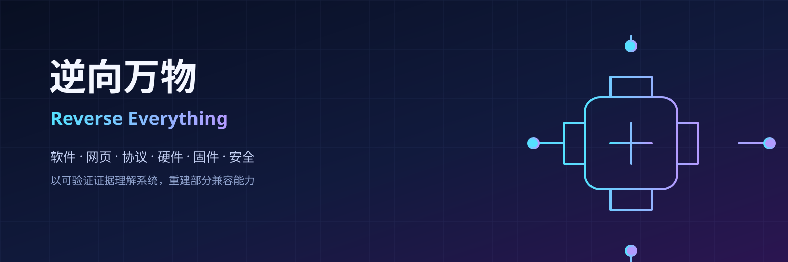
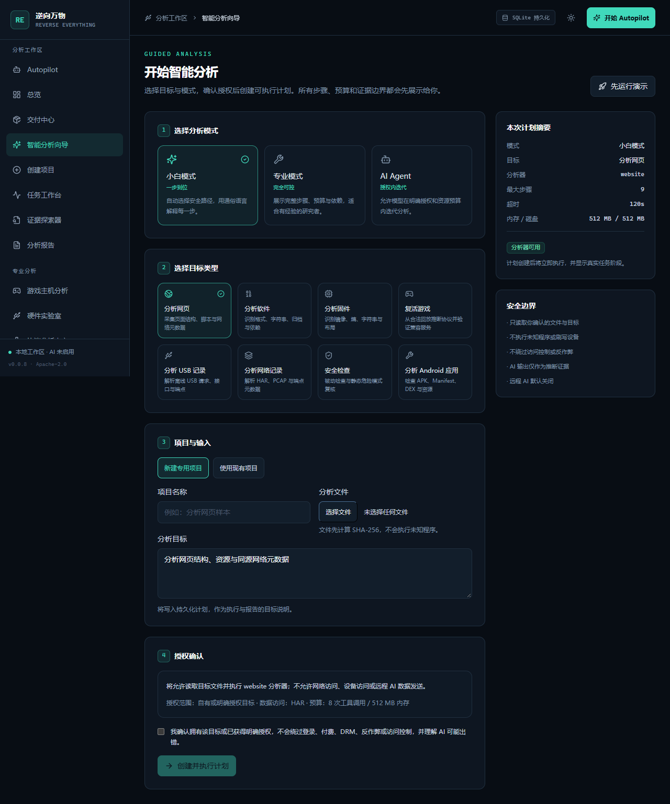
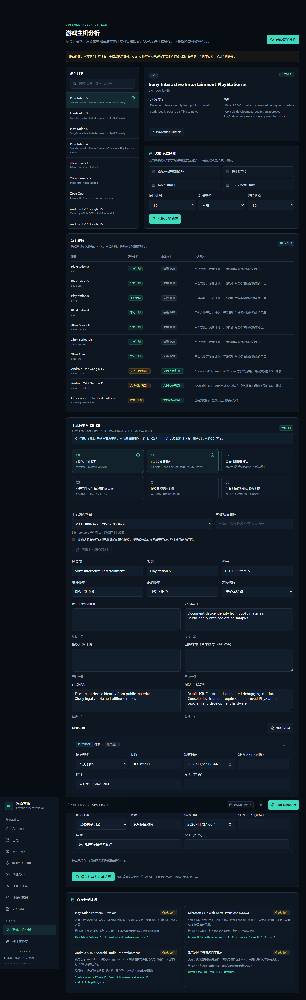
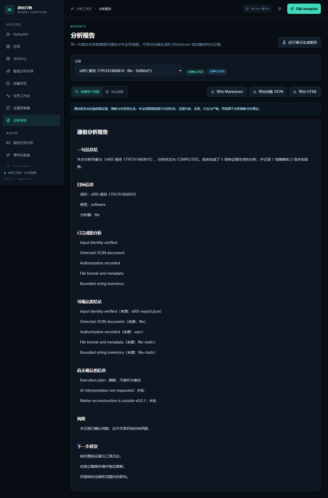

# 逆向万物 · Reverse Everything

**AI 辅助的本地逆向工程、主机研究与数字软件兼容重建工作台 · v0.0.6**

[](https://github.com/alicia1030su/reverse-everything/actions/workflows/ci.yml)
[](LICENSE)
[](https://github.com/alicia1030su/reverse-everything/releases/latest)
[English](README.en.md)



逆向万物把**已授权目标**转化为可追溯的分析任务：真实工具输出、持久化阶段、可恢复状态、可重复验证和可下载产物。v0.0.6 以 Game Revival 为主题，新增游戏复活工作台、L0-L7 证据等级、自有多人 FPS/RPG 服务端生成、管理后台与独立部署产物。

## 界面预览

| 智能分析向导 | 主机研究实验室 | 普通用户报告 |
|---|---|---|
|  |  |  |

> 仅分析你拥有或明确获授权的目标。不得绕过登录、验证码、付费、DRM、反作弊或访问控制。本项目不提供主机越狱、权限提升、安全启动绕过、自动漏洞利用或未授权设备访问。完整声明见 [DISCLAIMER.md](DISCLAIMER.md)。

## v0.0.6：Game Revival

- **Game Revival Studio**：保存合法保留的游戏档案，只读增量扫描本机目录，生成有证据边界的服务端规格。
- **L0-L7**：从档案、文件指纹、规格、生成构建、独立启动、真实同场联机到持久化/重连与 Docker 部署逐级验证；文件生成不等于复活成功。
- **自有多人 FPS/RPG**：生成独立 TypeScript/Node/WebSocket 服务端，包含权威状态、房间隔离、断线重连、持久化、结算、多房间并发与认证管理后台。
- **独立生成服务端**：产物不依赖本平台 API，可下载 ZIP 后在隔离环境构建、启动和部署。
- **全入口**：新增 `game profile|scan|spec|rebuild|status|download` CLI 命令、REST 路由与 7 个 MCP 工具，MCP 总数改为 44。
- **实测边界**：当前本地最高实测 L6；本机 Docker 不可用，Docker/L7 待 CI，未标为通过。

## 六种使用方式

| 方式 | 适合谁 | 入口 |
|---|---|---|
| Web 控制台 | 浏览器用户 | `npm start` 后打开 `http://127.0.0.1:4173` |
| Windows 桌面端 | 普通用户 | 安装 EXE 或解压 Portable |
| CLI | 脚本与自动化 | `reverse-everything` |
| REST API | 集成与自定义客户端 | `/api/v1` 或 `/api` |
| MCP | AI 客户端 | stdio 与 Streamable HTTP |
| Skill | 普通 AI 助手 | `skills/reverse-everything` |

## 快速开始

要求：Node.js **22.13+**、npm、Git。网页分析需要 Chrome/Chromium。

```bash
npm ci
npm run build
npm start
```

打开 <http://127.0.0.1:4173>。API 与 Web 同端口；启动时生成 `data/local-token`，不要在公开仓库提交 `data/`。

开发时只启动 API 与独立 Worker，不额外启动 Vite：

```bash
npm run dev
```

Docker：

```bash
docker compose up -d --build
curl http://127.0.0.1:4173/api/health
docker compose down          # 保留数据
docker compose down -v       # 删除数据卷
```

宿主端口只绑定 `127.0.0.1`；默认不映射 USB，也不使用 privileged。Windows 可使用安装包、Portable 或上述 Node.js 流程；Linux 使用 Node.js 22.13+ 或 Docker Compose。游戏目录扫描还需在 API 服务端显式配置 `RE_GAME_ROOTS`（Windows 用 `;` 分隔，Linux/Docker 用 `:` 分隔），只允许绝对路径及其子目录。Docker 只读挂载与配置示例见 [docker-compose.yml](docker-compose.yml) 和 [.env.example](.env.example)；当前本地 Docker 不可用，部署说明不代表 Docker/L7 已通过。

## Game Revival Studio

在“创建项目”中选择“游戏复活”，进入游戏复活工作台：

1. 保存游戏名称、FPS/RPG 类型、来源、授权范围与尚未恢复功能。
2. 配置 API 服务端 `RE_GAME_ROOTS`，填入允许目录内的本机绝对路径；未配置或越界均返回 403。
3. 只读增量扫描目录并计算文件指纹，不上传原始游戏文件。
4. 生成证据分级规格，再创建独立服务端重建任务。
5. 查看真实构建、双客户端同场、房间隔离、持久化、重连、结算与并发报告；下载通过验证的 ZIP。

L0 档案 → L1 扫描指纹 → L2 规格 → L3 生成并构建 → L4 独立启动与管理认证 → L5 双客户端同场/权威状态/房间隔离 → L6 持久化/重连/结算/多房间并发 → L7 Docker 部署。等级只由验证报告推进，不保证商业原客户端兼容，也不代表原始服务端恢复。

## 开始智能分析

1. 点击“开始智能分析”。
2. 选择 PS5、Xbox、Android TV、USB、固件、软件、Android、网页、游戏、协议或安全入口。
3. 提供文件、设备摘要或授权 URL，并确认合法分析范围。
4. 系统自动检测环境、选择可用分析器并生成有界计划。
5. 查看真实步骤、日志、证据和资源消耗。
6. 切换普通用户/专业报告视图并导出结果。

未配置 AI 时，确定性计划和规则型分析仍可运行。AI 文本始终标为 `INFERENCE`，不能替代工具证据。

## 游戏主机研究实验室

主机研究模块的目标对象是**游戏主机本体**，不是游戏控制器。

- 设备目录：PS5、PS5 Slim、PS5 Pro、PS4、Xbox Series X/S、Xbox One、Android TV、Android 电视盒子、其他开放式嵌入式设备。
- 档案：制造商、系列、型号、硬件版本、系统版本、官方接口、授权开发环境、固件样本、证据和限制。
- USB 诊断：只读判断系统识别、描述符、普通接口、拓扑、官方开发环境需求和硬件安全风险。
- 等级：C0 档案、C1 身份与官方资料记录、C2 合法接口、C3 静态分析、C4 授权开发环境实测、C5 自有设备独立兼容实现。C1 仅表示资料已记录；C2 及以上只计入后端验证证据，用户自述不能提升等级。

设备出现在目录中不代表已经支持其内部系统分析。USB Type-C 外形不能作为调试依据；不支持普通零售主机对主机连接。

详见 [主机研究指南](docs/user-guide/CONSOLE-RESEARCH.md)、[PS5](docs/user-guide/PS5.md)、[Xbox](docs/user-guide/XBOX.md)、[Android TV](docs/user-guide/ANDROID-TV.md)。

## 能力入口

| 入口 | 输入与输出 | 实际路由与边界 |
|---|---|---|
| `website` 网页 | DOM、脚本、路由、表单、截图、同源网络元数据 | `website` adapter；不绕过访问控制 |
| `software` 软件 | PE/ELF/Mach-O、section/import、熵、有界字符串、ZIP、SBOM | `file` adapter；不执行未知程序 |
| `android` Android | APK/ZIP 安全清单、AXML Manifest、DEX 表与原生库元数据 | `apk` adapter；JADX 反编译需官方工具 |
| `game` 游戏复活 | 合法回放的协议字段、状态转换、独立兼容服务 | `game` adapter；不是原始服务端恢复 |
| `network` 网络协议 | HAR、PCAP、PCAPNG 的端点、HTTP/DNS/TLS 与传输元数据 | `network` adapter；只解析离线上传 |
| `security` 安全 | 被动 HTTP 头/Cookie/CORS、静态 CWE 候选、SARIF | `security` adapter；不进行漏洞利用 |
| `usb` USB 硬件 | USB 身份/拓扑、离线 PCAP/PCAPNG/usbmon、HID 描述符、快照 | `hardware` adapter；只读枚举，不打开设备 |
| `firmware` 固件 | BIN/IMG、Intel HEX、UF2、ELF、布局、熵、字符串、组件/SBOM 线索 | `firmware` adapter；静态有界分析，不刷写 |
| `board` 开发板 | 开发板 USB/HID/枚举记录与只读串口列表 | `hardware` adapter；不虚构特定型号或实时权限 |
| `console` 主机研究 | 设备档案、USB 诊断、C0-C5 证据、离线样本与报告 | `console` adapter；不执行设备操作或绕过 |

Ghidra Headless 是 `software` 卡片内的高级选项，使用独立 `ghidra` adapter。Ghidra 12.2 与 JADX 1.5.3 已通过官方工具已知答案 CI；不覆盖所有格式、架构或物理设备。

## CLI 示例

```bash
reverse-everything --version
reverse-everything health
reverse-everything capabilities
reverse-everything console devices
reverse-everything projects create "我的授权样本" software --authorized
reverse-everything projects upload <projectId> ./sample.bin
reverse-everything analyze file ./sample.bin --authorized
reverse-everything plans create <projectId> "总结离线请求" ./capture.har --authorized
reverse-everything plans execute <planId>
reverse-everything demos list
reverse-everything demos run firmware
reverse-everything report plain <taskId> ./report.md
reverse-everything game profile <projectId> "自有 FPS" fps /absolute/games/owned-fps --authorized
reverse-everything game scan <projectId> /absolute/games/owned-fps --authorized
reverse-everything game spec <projectId>
reverse-everything game rebuild <specId>
reverse-everything game status <rebuildId>
reverse-everything game download <rebuildId> ./server.zip
reverse-everything mcp stdio
reverse-everything mcp http --port 4174
```

本地 URL 需 `--confirm-local`。默认读取 `RE_DATA_DIR/local-token`，可用 `RE_API_URL`、`RE_API_TOKEN`、`RE_DATA_DIR` 覆盖。完整命令见 [CLI 指南](docs/user-guide/CLI.md)。

## REST API、OpenAPI 与 MCP

- API：`http://127.0.0.1:4173/api/v1`；兼容 `/api`。
- OpenAPI：运行时 `GET /api/openapi.json`。
- MCP：stdio 与 Streamable HTTP 共用 API，共 **44 个工具**，新增 `list_game_profiles`、`save_game_profile`、`scan_game_directory`、`create_game_server_spec`、`list_game_rebuilds`、`create_game_rebuild`、`get_game_rebuild`。
- Skill：`skills/reverse-everything`，优先使用 MCP，否则使用 CLI/API。

所有入口共用后端授权、Schema、预算和结构化错误。清理、设备打开、实时捕获、刷写、驱动安装和任意宿主任意命令执行不暴露给 MCP。

## 安全与隐私

- 默认只读、本地保存、凭证脱敏、隔离未知程序。
- 默认禁止任意硬件写入、驱动安装、管理员操作和宿主任意命令执行。
- 默认不上传用户样本到远程 AI；远程共享必须显式同意。
- 设备可控自由文本默认仅返回单向哈希。
- 未授权物理设备不访问；实时 USB 捕获、驱动安装和刷写保持禁用。
- 固件只做有界静态识别；加密或高熵内容保持 `UNKNOWN`。

详见 [安全策略](SECURITY.md) 与 [免责声明](DISCLAIMER.md)。

## 下载

| 平台 / 形态 | 文件 |
|---|---|
| Windows 安装包 | [Reverse-Everything-Setup-0.0.6-win-x64.exe](https://github.com/alicia1030su/reverse-everything/releases/latest/download/Reverse-Everything-Setup-0.0.6-win-x64.exe) |
| Windows Portable | [Reverse-Everything-Portable-0.0.6-win-x64.zip](https://github.com/alicia1030su/reverse-everything/releases/latest/download/Reverse-Everything-Portable-0.0.6-win-x64.zip) |
| CLI | [reverse-everything-cli-0.0.6.tgz](https://github.com/alicia1030su/reverse-everything/releases/latest/download/reverse-everything-cli-0.0.6.tgz) |
| Server | [reverse-everything-server-0.0.6.tar.gz](https://github.com/alicia1030su/reverse-everything/releases/latest/download/reverse-everything-server-0.0.6.tar.gz) |
| Skill | [reverse-everything-skill-0.0.6.zip](https://github.com/alicia1030su/reverse-everything/releases/latest/download/reverse-everything-skill-0.0.6.zip) |

下载 `SHA256SUMS.txt` 后运行 `sha256sum -c SHA256SUMS.txt` 验证资产。Windows 安装包未签名，可能触发 SmartScreen；不伪造代码签名。

## 测试与文档

```bash
npm run typecheck
npm run lint
npm test
npm run test:e2e
npm run docs:check
npm run validate:skill
npm run version:check
```

测试数量、跳过项、CI Run ID 与门禁结论以 [v0.0.6 测试结果](docs/development/V006-TEST-RESULTS.md) 为准；未运行的检查不标为通过。当前本地 Docker 不可用，最高实测 L6，L7 待 CI。

- [PRD](docs/PRD.md) · [架构](docs/ARCHITECTURE.md) · [安全模型](docs/SECURITY-MODEL.md) · [路线图](docs/ROADMAP.md)
- [小白指南](docs/user-guide/BEGINNER.md) · [主机研究](docs/user-guide/CONSOLE-RESEARCH.md)
- [CLI](docs/user-guide/CLI.md) · [CLI/MCP](docs/user-guide/CLI-MCP.md) · [API](docs/user-guide/API.md) · [Skill](docs/user-guide/SKILL.md)
- [Windows](docs/user-guide/WINDOWS.md) · [升级](docs/user-guide/UPGRADE.md) · [能力矩阵](docs/development/V006-CAPABILITY-MATRIX.md)

## 许可证

Apache-2.0。第三方组件遵循各自许可证；详见 [NOTICE](NOTICE) 与 [免责声明](DISCLAIMER.md)。不得使用本项目分发未经授权的商业软件、固件或游戏资源。
