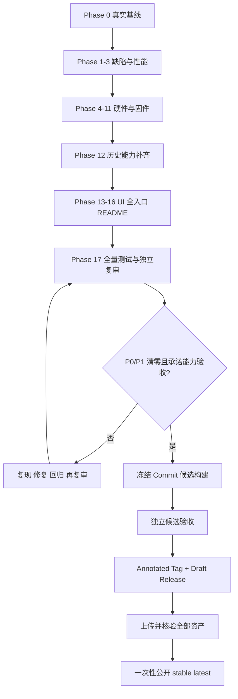
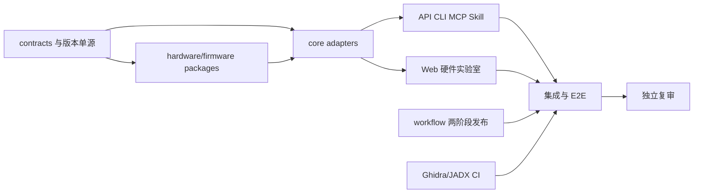
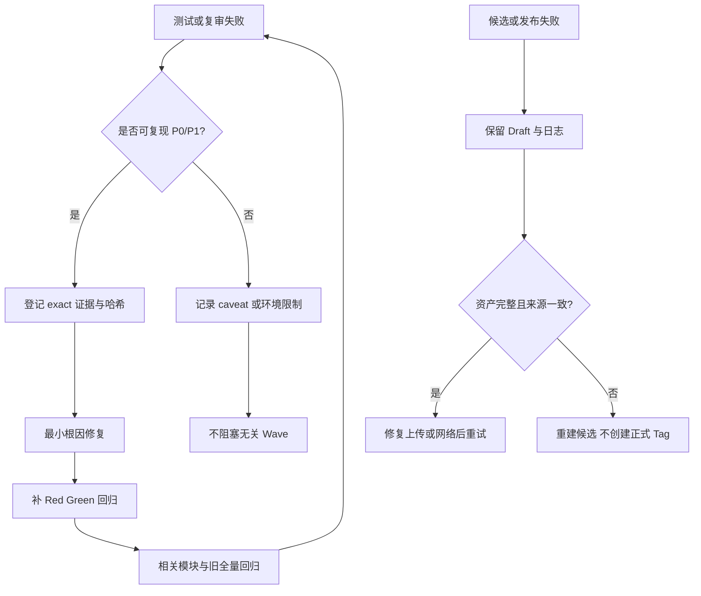

# v0.0.4 实施计划

## 项目启动

- 项目：逆向万物 v0.0.4 硬件逆向实验室、全量缺陷整治、性能优化与正式发行。
- 技术栈：Node 22、TypeScript、React/Vite、Electron、Fastify、SQLite WAL、npm workspaces。
- 终极验收：从冻结 Commit 构建的 v0.0.4 正式 Release，旧能力不退化，工件完整性不退化，硬件离线分析与系统只读枚举真实验收，全部确认 P0/P1 清零。
- In scope：审计修复、性能、硬件/固件、历史能力补齐、Web/桌面、全入口、README、测试、独立复审、原子发布。
- Out of scope：自动刷写/擦除/驱动安装、全总线自动捕获、DRM/Secure Boot/认证绕过、商业主机漏洞利用、未经授权设备访问、自动操作个人文件。
- 用户已授权项目内 Git/PR/正常合并/正式发布；不构成访问所有连接设备或安装系统驱动的授权。

## PLAN-GATE

- A1 需求映射：Phase 0–20 均在下表对应 Wave。
- A2 出口校验：每个 Wave 有命令、测试或 CI 证据。
- A3 外部依赖：Ghidra 12.2（官方 SHA256 `2c2cd776…`）、JDK 25、JADX、Wireshark 官方样本、Windows/Linux 系统 API。
- A4 风险：恶意固件/描述符、TOCTOU、事件循环阻塞、缓存污染、多实例、设备授权、发行不完整。
- A5 证据：命令输出、测试报告、真实工具日志、公开样本哈希、GitHub Release digest。
- A6 回滚：源码用新提交回退；数据库 Schema 4 迁移前备份并保留损坏库；发布失败保留 Draft 和证据，不移动 Tag、不覆盖正式资产。
- A7 批量范围：新增 packages/hardware、packages/firmware、core adapters、API/CLI/MCP/Skill/Web/tests/docs/workflows。
- A8 安全触发：外部文件、USB 设备、网络 MCP、SQLite、文件替换、AI 工具调用、发布凭证。
- A9 人工文件：不覆盖用户 data/、桌面、下载、个人目录；仅项目工作树。
- A10 恢复：`V004-PROGRESS.md`、`.ai-memory/handoff.md`、各 validation/test 文档。
- B1 数据库：Schema 4 仅添加设备授权/分析元数据，迁移失败回滚并保留备份。
- B2 新依赖：优先系统 API；如引入 serialport/JADX wrapper，先审查许可证、漏洞和锁文件。
- B3 并发：租约、项目锁、GC、发布、取消、设备重连全部确定性交错测试。
- B4 性能：先基线后优化；同硬件同输入 P50/P95/P99、内存、event-loop delay。
- B5 外部接口：API 版本兼容，旧路由保留；MCP 旧工具名保留。
- B6 测试：旧 343 项 + 新硬件/固件/安全/性能/文档测试。
- B7 批处理：大文件分块、有界缓存、按需启动、CI 分阶段串行。
- B8 不可逆：正式 Tag/Release 仅在候选完整验收后；不覆盖历史版本。
- B9 影响面：改 contracts 后全仓 typecheck；改 engine 后 workflow/API/worker/资源/缓存回归。
- B10 脚本：路径参数化、超时、输出上限、信号清理、无 token 日志。
- B11 回读：文档链接、JSON、生成 OpenAPI、Markdown 渲染与发行清单。
- C1 每 5 个文件或每个 Wave 更新进度/检查点。
- C2 长任务按 Wave 执行，已验收 Wave 不重复。

## 主流程

## 依赖与并行

## 失败回退

## Wave 执行表

| Wave | 内容 | 关键文件 | 出口证据 |
|---|---|---|---|
| 1 | 基线、版本单源、Schema 4 规划 | V004-*、VERSION、contracts | 基线复核、bump 测试 |
| 2 | 两阶段工件发布 | workflow/engine、evidence、workflow tests | 安全回归+1GB 条件基准+事件循环/锁指标 |
| 3 | 缓存归因、资源采样、桌面指标 | cache/resources、desktop sidecar、benchmark | 冷热 P50/P95/P99、采样故障矩阵、真实桌面内存 |
| 4 | Windows 文件安全、游戏属性测试 | evidence、api、game tests | Windows CI Junction/Reparse/替换；随机/长稳 |
| 5 | device contracts、USB 枚举、HID/serial 只读 | packages/hardware、core/hardware adapter | Windows/Linux collector 测试、真实系统只读枚举 |
| 6 | USB PCAP/PCAPNG/usbmon、HID 描述符 | hardware parser、官方样本脚本 | Wireshark 官方样本来源/许可证/SHA/预期结构对照 |
| 7 | 固件静态分析 | packages/firmware、core/firmware adapter | BIN/HEX/UF2/ELF/签名/熵/字符串/恶意输入 |
| 8 | Ghidra 伪代码/调用图、JADX | ghidra/apk adapters、CI tools | 官方工具真实 PE/ELF/APK 已知答案 |
| 9 | AI 安全计划执行、网页行为对比 | workflow/ai、website | 越权/预算/无进展；多页面行为验证 |
| 10 | API/CLI/MCP/Skill/OpenAPI | apps/api/cli、mcp、skills | 双传输、硬件最小权限、全入口契约 |
| 11 | Web/桌面实验室、首次引导 | apps/web/desktop | 真实截图、Web/Electron E2E、移动布局 |
| 12 | README/用户指南/品牌/链接 | README*、docs/assets、user-guide | 链接、命令、能力一致性测试 |
| 13 | 全量测试、独立复审、性能/安全报告 | tests、V004-* | P0/P1=0，冻结哈希 |
| 14 | 候选、原子 Draft 发布、公开复验 | release workflows/scripts | Tag=Build=Acceptance，12+ 资产 digest，stable latest |

## 实测证据

| 日期 | 命令 / 样本 | 结果 | 结论 |
|---|---|---|---|
| 2026-11-25 | `git ls-remote` + GitHub Release API | main/Tag/Release 一致；12 资产 uploaded | v0.0.3 来源基线可信 |
| 2026-11-25 | `npm run typecheck && npm run lint` | 通过 | 静态基线干净 |
| 2026-11-25 | `npm test` | 343 passed/3 skipped；清理保护失败 | 产品断言通过，测试清理需修 |
| 2026-11-25 | 官方 Wireshark `usb-hid.pcapng` | SHA256 `893f285dce30121687f164c57572dc873595a7bc289dde3596b7bb0ec160bc34` | 真实公开离线样本已取得 |
| 2026-11-25 | 官方 `usb_coverage.pcapng.gz` 解压 | SHA256 `98b5742ef016ea9fb1c2b1035e44f4552262ce69a86255b20f31eeb44d884b3e` | 真实 USB 描述符/传输样本已取得 |
| 2026-11-25 | 官方 `usb_hid_coverage.pcapng.gz` 解压 | SHA256 `24d751a1625f7ea5a9f9390987f7bce28667c8b87be4251bc0f214b4657372a3` | 真实 HID 样本已取得 |
| 2026-11-25 | GitHub Ghidra latest API | 12.2，ZIP SHA256 `2c2cd776db3c1f6a097ba418922378ac3649cadd5e844a6f5f088ae628a7be67`，JDK 25 | 固定官方工具链依据 |
