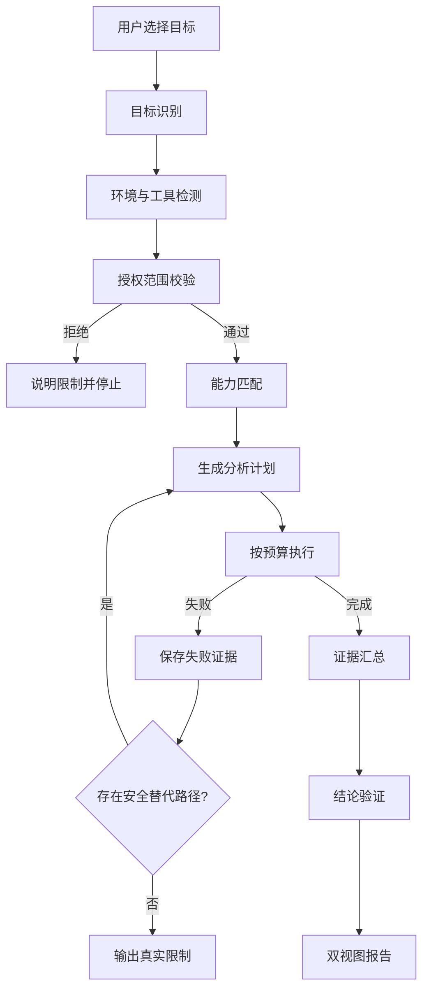
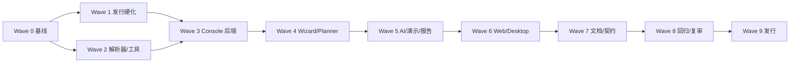
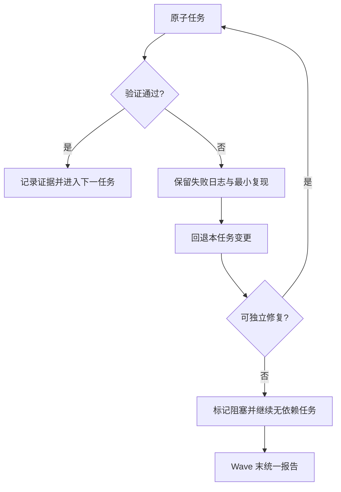

# v0.0.5 实施计划

## 项目启动信息

- 项目名称：逆向万物 Reverse Everything v0.0.5
- 项目类型：本地桌面/Web/API/CLI/MCP/Skill 一体化逆向研究工作台
- 业务目标：在保持证据优先与安全边界的前提下，新增游戏主机研究实验室、智能逆向向导、自动分析计划与 AI V3，并发布正式版本。
- 终极功能：用户选择合法目标后，系统自动检测、规划、执行可支持的分析步骤，生成可追溯证据与双视图报告；真实设备未提供时不伪造验证。
- 技术栈：Node.js 22、TypeScript、React/Vite、Fastify、SQLite、独立 Worker、Electron、Playwright、Ghidra/JADX 按需外部工具。
- 默认循环轮次：3；安全最大轮次：6；每轮最大改动点：3（复杂 Wave 内按原子任务推进）。
- 角色配置：主控、架构、后端、前端、测试、独立复审、发行。

## 需求锁定

- 状态：LOCKED，见 `.ai-memory/20261125/requirement_lock_20261125-2312.md`。
- 用户已授权完整开发、测试、安全审查、性能优化、文档、PR、合并与正式发布，不要求逐阶段确认。
- 外部阻塞：真实 PS5/Xbox/Android TV、管理员权限、签名证书、外部账号未提供；记录后继续其他工作。

## 架构决策

### 决策 1：新增 `packages/console` 领域包

- 职责：设备目录、主机档案校验、C0-C5 等级、USB 连接诊断、官方开发环境指引、主机研究报告。
- 不直接访问设备、不发送 USB 指令、不执行固件。
- 撤销条件：若后续所有主机能力都可被 hardware/firmware 无循环依赖吸收，可合并回现有包。

### 决策 2：新增 `packages/planner` 计划包

- 职责：目标检测、能力匹配、分析器选择、依赖状态、计划 Schema、预算、自适应重规划。
- 默认确定性规划；AI 仅提供受限建议，所有工具调用仍由后端 Schema/权限/预算拦截。
- 撤销条件：若计划逻辑持续小于单模块边界，可迁移到 workflow；出现循环依赖前必须拆分。

### 决策 3：Schema 4 持久化新实体

新增 `console_profiles`、`analysis_plans`、`authorization_scopes`、`tool_installations`、`demo_runs` 五类表；保留 Schema 3 升级路径与迁移前备份。所有新表必须可由现有 BackupService 完整备份/恢复。

### 决策 4：复用统一任务引擎

主机档案、工具安装、演示运行不创建孤立 daemon。需要执行分析的场景统一创建 Project/Task，复用 Worker、证据、预算、取消、fencing 与报告链路。

### 决策 5：发行 Release ID 驱动

正常发行只使用仓库内版本化工作流和 `release-atomic.mjs`；Draft 查找分页、显式 Release ID、幂等上传、限流重试、公开后复验均纳入脚本与测试，不再依赖临时恢复工作流。

## 模块边界

```text
contracts
  ├── console/planner/auth/report/tool/demo types
  ├── workflow
  ├── hardware
  ├── firmware
console ──> contracts
planner ──> contracts
core ──> console, firmware, planner, workflow
api ──> core, workflow, console, planner
cli/mcp ──> API contracts
web/desktop ──> API contracts
```

禁止：console 直接访问 USB；planner 直接执行命令；Web 自行扩大授权；MCP/CLI 绕过 API 权限。

## Wave 执行计划

### Wave 0：Phase 0 基线（当前）

- 重新核实仓库、Release、资产、测试、性能、能力与文档。
- 产出 `V005-BASELINE.md`、`V005-DEFECT-REGISTER.md`、`V005-CAPABILITY-MATRIX.md`、`V005-PLAN.md`。
- 出口：四份文档存在且 `docs:check` 通过；基线数据可追溯到命令/API。

### Wave 1：发行脚本硬化

- 实现分页 Draft 查找、显式 Release ID 校验、统一 API 重试/限流、上传恢复、公开后复验。
- 安全清理 v0.0.4 残留空 Draft。
- 补分页、错误 ID、429/503、断流、重复 Draft、正式资产保护测试。
- 出口：发行脚本测试全绿；不创建 v0.0.5 Tag。

### Wave 2：解析器与外部分析器稳定性

- 审计 firmware/APK/PCAP/HAR/USB/JSON/归档/反编译输出内存边界。
- 补 64MB/128MB 受限堆回归。
- 统一 JADX/Ghidra 执行适配层。
- 出口：故障矩阵与真实工具 CI 通过；P0/P1 清零。

### Wave 3：Console Research Lab 后端

- 新增 console package、Schema 4、console adapter、REST/CLI/MCP 基础契约。
- 实现设备目录、档案、能力等级、连接诊断、官方指引、报告。
- 出口：单元/集成/E2E 覆盖档案与证据等级；无真实设备时正确 BLOCKED。

### Wave 4：Wizard、Planner、授权与工具管理

- 新增 planner package、三模式向导、自动检测/计划、授权范围中心、工具管理器。
- 所有入口共用后端授权与预算。
- 出口：API/MCP/CLI/Web 端到端计划任务可运行，权限绕过负向测试通过。

### Wave 5：AI V3、演示与双视图报告

- 扩展受限 Agent 角色、自适应失败处理、预算与无进展检测。
- 新增内置演示与普通用户/专业报告视图及导出。
- 出口：fake model 故障矩阵、演示验收、报告一致性测试通过。

### Wave 6：Web/Desktop 体验

- 新增主机实验室、向导、计划、工具中心、演示、授权、报告页面。
- 桌面首页突出智能分析；真实进度、错误说明、首次使用提示。
- 出口：Web/Electron E2E 与可用性验收通过。

### Wave 7：文档与全入口契约

- 更新中英文 README、免责声明、 Beginner/Console/PS5/Xbox/Android TV 指南。
- 同步 OpenAPI、MCP、Skill、CLI、Server、Desktop、Docker。
- 出口：docs/version/Skill/OpenAPI/MCP stdio+HTTP/CLI TGZ/Server TGZ/EXE/Portable/Docker 验收通过。

### Wave 8：全量回归与独立复审

- 执行 Phase 14 全量门禁。
- 独立复审主机/硬件边界、AI 权限、文件/固件、数据并发、内存性能、发行文档。
- 出口：P0=0/P1=0，所有跳过项有原因，性能不明显退化。

### Wave 9：候选与原子发行

- 版本同步到 0.0.5，PR 合并，冻结最终 Commit。
- 候选构建、独立验收、provenance、SHA-256。
- annotated Tag、唯一 Draft、Release ID 上传、完整校验、一次性发布、Latest、公开复验。
- 出口：Tag=Build=Acceptance Commit，12+ 资产完整，公开地址复验通过。

## 主流程



## Wave 依赖



## 失败回退路径



## 验证策略

- 每个原子任务必须有命令/测试/API 响应证据。
- 内存回归使用子进程 `--max-old-space-size=64/128`，覆盖 32/64/128MB 输入。
- 外部分析器同时使用 fake tool 故障矩阵和官方真实工具 CI。
- UI 使用 Web E2E + Electron E2E，不伪造截图。
- 发行使用故障注入与公开地址复验。
- 独立复审只读输出问题清单，主控复核后才计入完成。

## 实测证据

| 任务 | 命令 / 来源 | 结果 | 结论 |
|---|---|---|---|
| 仓库状态 | `git status`、GitHub API | main 一致，无开放 PR/Issue | 基线可信 |
| 测试 | `npm test -- --reporter=json` | 50 files，528 passed / 8 skipped / 0 failed | 旧功能基线通过 |
| 性能 | `node scripts/benchmark.mjs --engine --samples 7 --warmup 2` | 全部门禁通过；hot hit=1.0，writes=0，peak RSS=144.21MB | 历史性能缺陷当前未复现 |
| Release | GitHub API + provenance 文件 | v0.0.4 public/latest，12 资产一致 | 来源链完整 |
| 文档 | 只读核查 | README/能力矩阵/roadmap/handoff 过期 | 纳入 Wave 7 修复 |
